# FairFare

**Know the fair moto price before you get on the bike.**

FairFare is an Android app for moto-taxi passengers in Kigali. Look up a route such as Kacyiru → Kimironko and see what other passengers usually pay: a price range, the median, and how many reports back it up. Use that number when you negotiate, then report what you paid so the next person gets a better answer.

FairFare does not set prices, dispatch drivers, or take a commission. It answers one question: **what does this trip usually cost?**

> Built for the ALU Mobile Application Development summative (Term 6). The graded build is the Android app, on a physical phone or an emulator.

## Contents

- [Why FairFare](#why-fairfare)
- [Features](#features)
- [Screenshots](#screenshots)
- [How it works](#how-it-works)
- [Tech stack](#tech-stack)
- [Repository layout](#repository-layout)
- [Getting started](#getting-started)
- [Tests and code quality](#tests-and-code-quality)
- [Database and security rules](#database-and-security-rules)
- [Admin tasks](#admin-tasks)
- [Known limitations and future work](#known-limitations-and-future-work)
- [Team](#team)
- [Credits](#credits)

## Why FairFare

- Moto-taxis are Kigali's main last-mile transport, and there is no meter. Every fare is negotiated on the spot, so the driver always knows more than the passenger.
- New and international students feel this most. They have no local price knowledge and are easy to spot as newcomers.
- Ride-hailing apps fix prices but take a 15–20% commission that many drivers refuse, so most passengers still negotiate blind on street motos.

FairFare gives passengers a shared price reference that they build together and can check.

## Features

| Area | What a passenger can do |
|---|---|
| **Sign in** | Register with email and password (with email verification), sign in with Google, reset a forgotten password. The session survives an app restart. |
| **Corridors** (home tab) | Pick pickup and dropoff areas (or use the phone's location to find the nearest area) and see the price range, median, sample size, a confidence tag and when the price was last updated. A "verify on chain" link opens the Cardano testnet record of the published prices. |
| **Saved routes** | Add, edit and delete favourite routes. Tap one to open it on the Corridors tab. |
| **Report** (tab) | Report the price paid after a ride: route, price, time of day and heavy rain. A banner shows the report's status and the 48-hour countdown. |
| **My reports** | See every report with its status. Edit the price or delete a report while it is still pending. The status changes live when the server verifies, rejects or expires it. |
| **Pass** (tab) | Pay for a 30-day Pass with mobile money (the app opens the dialer with the USSD code), then enter the payment reference. The status flips to active once a team member approves it. |
| **Wallet** (tab) | See pending and finalized reward points and a history of rewards. Request a cash-out to MTN MoMo or Airtel Money. |
| **Profile** | Trust score (0–100), reporting streak, badges (Corridor Pioneer, Week Streak, Ten Verified), a top-10 leaderboard, and an editable display name and avatar. |
| **Settings** | Theme (system, light, dark), default time of day, replay the welcome screen, account details and log out. Settings are saved with `shared_preferences` and restored on the next launch. |

The app handles loading, empty and error states on every screen, and the layouts work in portrait and landscape.

## Screenshots

<!-- Put the PNGs in docs/screenshots/ with these names. -->

| Landing | Sign in | Corridors | Saved routes |
|---|---|---|---|
| 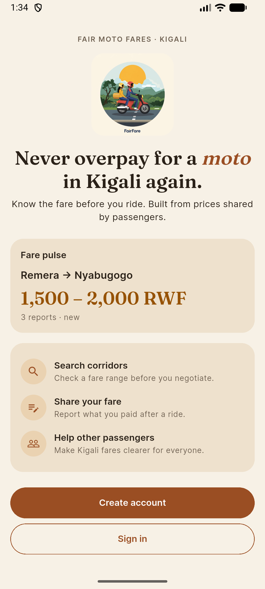 | 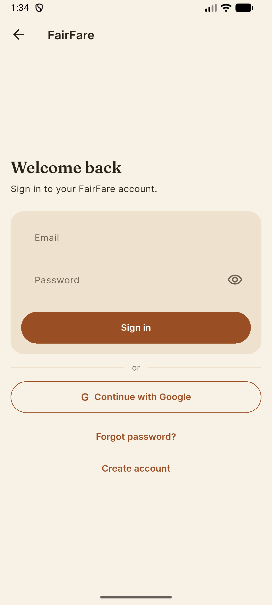 | 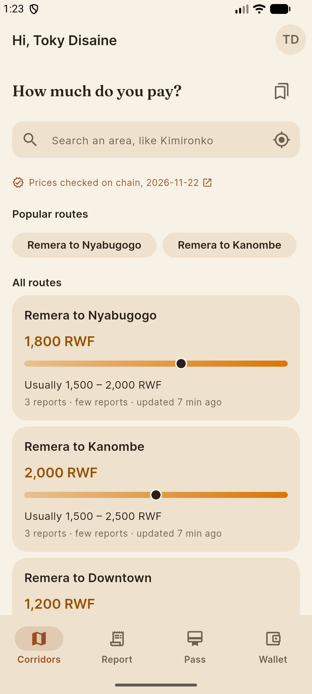 | 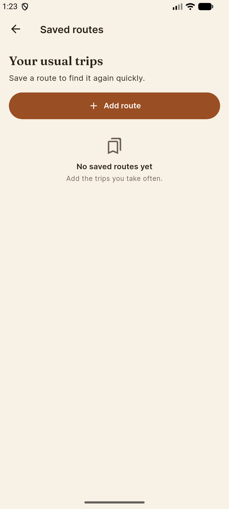 |

| Report | My reports | Pass | Wallet |
|---|---|---|---|
| 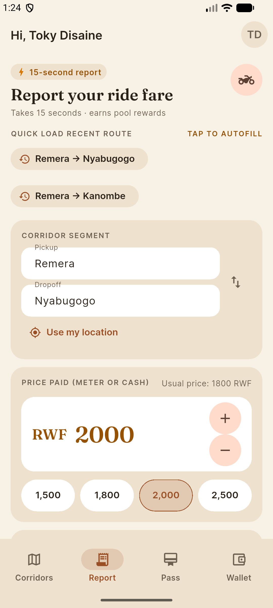 | 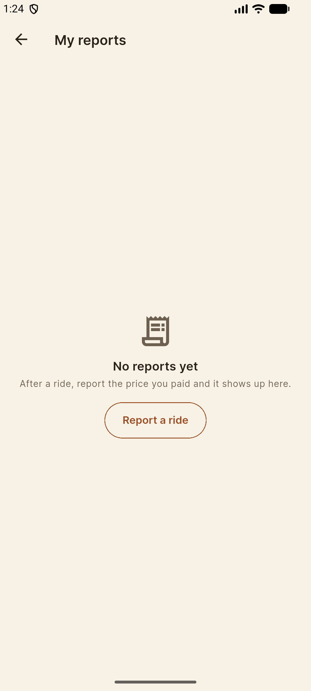 | 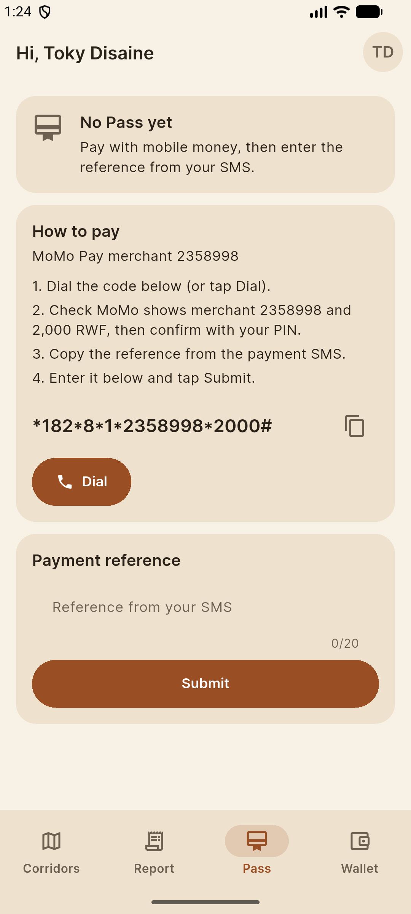 | 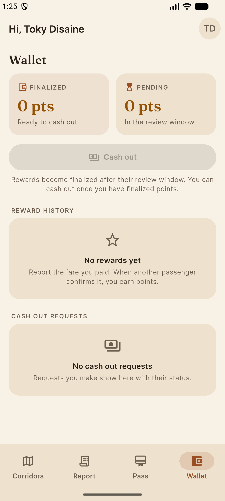 |

| Profile | Settings | Dark theme | Landscape |
|---|---|---|---|
| 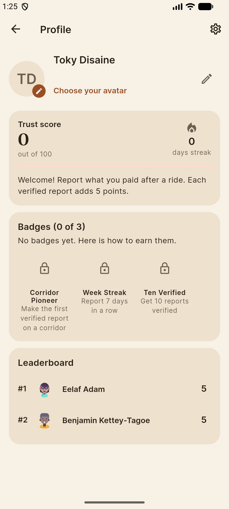 | 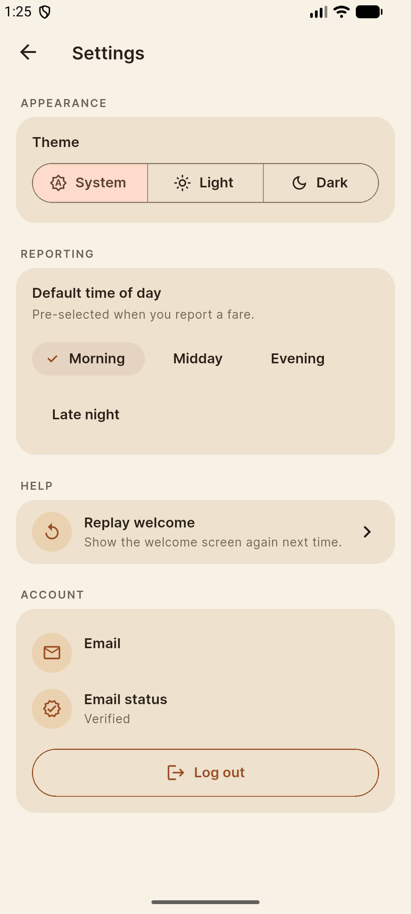 | 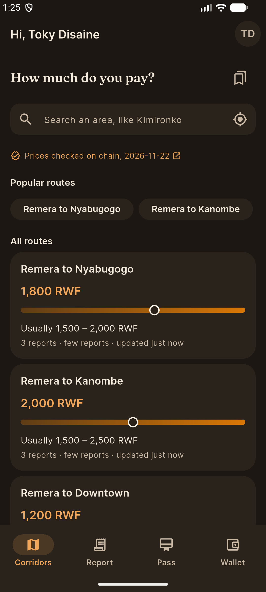 | 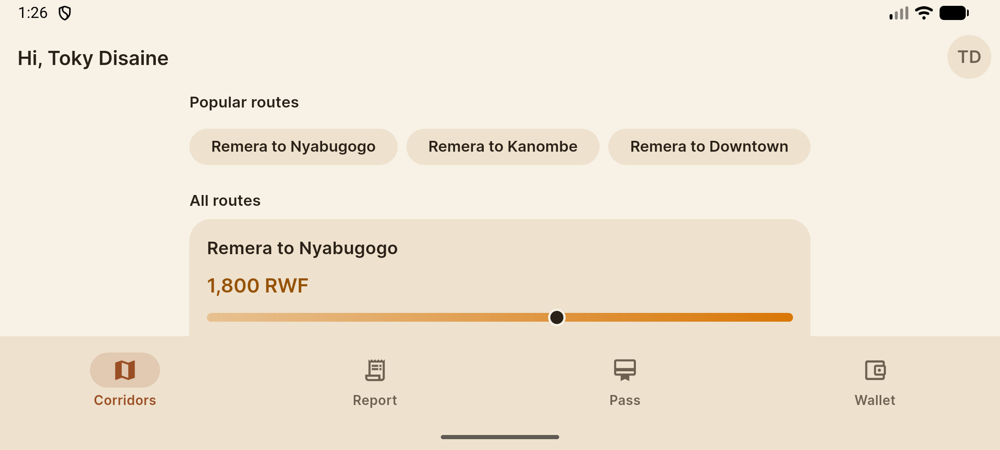 |

## How it works

### Who talks to the database

```
   Flutter app   ⇄   Cloud Firestore   ⇄   NestJS server   →   Cardano testnet
   (security rules apply)        (Admin SDK, trusted)       (price fingerprint)
```

- The **Flutter app** reads and writes Firestore directly, always through the security rules. It may only create and edit its own pending data.
- The **NestJS server** uses the Firebase Admin SDK and does the jobs a phone must never be trusted with: deciding whether a report is verified, paying rewards, calculating corridor prices, updating trust scores and approving payments.
- The **blockchain** only sees a SHA-256 fingerprint of the aggregated, anonymized price table. It never sees a single report or anything that identifies a passenger.

### The life of a report

1. A passenger submits a report. The app writes it to Firestore with status `pending`.
2. The server's verify engine picks it up and runs the **band check**: is the price between 50% and 150% of the corridor median (up to 200% in heavy rain or late at night)? If not, the report is `rejected` with a reason. The first 3 reports on a new corridor skip this check.
3. The report waits for **corroboration**: a different passenger reporting a price within 10% on the same corridor and time of day, within 48 hours. A match makes both reports `verified`. No match after 48 hours makes it `expired`, with no reward and no penalty.
4. When a report is verified, the server raises a `report.verified` event and three engines react:
   - the **aggregate engine** recalculates the corridor's range and median over a 14-day window,
   - the **reward engine** adds a pending reward to the passenger's wallet,
   - the **trust engine** adds 5 to the trust score (a rejection takes away 3) and updates the streak and badges.
5. The app's screens listen to Firestore, so the passenger sees the change with no refresh.

### Rewards and the Pass

A Pass costs 2,000 RWF for 30 days. When a payment is approved, the server splits it into the reward pool (35%), operations (45%) and a reserve (20%). Each verified report earns the pool balance divided by the number of reports the pool should cover, times 1.5 for the first report on a corridor or 0.5 for a confirming report. Rewards are never more than the pool holds, so the pool cannot run dry. A reward stays pending for a hold period (24 hours by default) before it can be cashed out.

### Layers inside the app

Every feature in `app/lib/features/` follows Clean Architecture:

```
presentation   screens, small widgets, Riverpod providers
     │
domain         entities, repository interfaces, use cases, pure rules
     │           (no Flutter or Firebase imports)
data           Firestore repository implementations and models
```

Screens never call Firestore. They ask a provider, the provider asks a repository, and the repository talks to Firestore. Business rules such as price sanity, cash-out limits and payment reference format live in the domain layer, where they are unit tested. App state is managed with Riverpod, not `setState`.

## Tech stack

| Part | Tools |
|---|---|
| Mobile app | Flutter 3.47.6 (Dart 3.13), Riverpod, go_router, shared_preferences, google_fonts, geolocator, url_launcher, intl |
| Auth and database | Firebase Authentication (email/password and Google), Cloud Firestore with security rules |
| Server | NestJS 12 on Node 22, Firebase Admin SDK, `@nestjs/event-emitter`, Vitest, oxlint |
| Trust layer | Cardano testnet (preview or preprod) through Mesh SDK and Koios |
| Rules tests | `@firebase/rules-unit-testing` on the Firestore emulator |
| CI | GitHub Actions: Flutter format, analyze, test and coverage; backend lint, test and build |

## Repository layout

```
fairfare/
├─ app/                      Flutter mobile app
│  ├─ lib/
│  │  ├─ main.dart           starts Firebase, loads preferences, runs the app
│  │  ├─ app.dart            MaterialApp.router with the theme
│  │  ├─ router.dart         routes, the 4-tab shell and auth redirects
│  │  ├─ core/               constants, Firestore paths, theme, validators, formatters
│  │  ├─ shared/widgets/     reusable widgets (buttons, cards, price stepper, banners...)
│  │  └─ features/           one folder per feature, each with domain/data/presentation
│  │     ├─ auth/  landing/  splash/  corridors/  saved_routes/  report/
│  │     └─ pass/  wallet/  profile/  settings/
│  └─ test/
│     ├─ unit/               validators, repositories, domain rules, router redirects
│     ├─ widget/             screen tests
│     └─ fakes/              in-memory fake repositories used by the tests
├─ backend/                  NestJS server (trusted logic only)
│  └─ src/
│     ├─ firebase/           Admin SDK setup, emulator support
│     ├─ reports/            verify engine: band check, corroboration, expiry sweep
│     ├─ corridors/          aggregate engine (corridor stats)
│     ├─ wallet/             reward engine and reward formula
│     ├─ trust/  engagement/ trust score, streaks, badges, leaderboard
│     ├─ payments/           Pass approval endpoints, guarded by ADMIN_KEY
│     ├─ notary/             Cardano testnet notarization
│     └─ seed.ts             starter zones, corridors and prices
├─ rules_tests/              Firestore security rules tests (emulator)
├─ docs/                     ERD, security rules, contrast check, report notes
├─ firestore.rules           security rules
├─ firestore.indexes.json    composite indexes
├─ firebase.json             Firestore and emulator config
└─ .github/                  PR template, CODEOWNERS, CI workflows
```

## Getting started

### What you need

- **Flutter 3.47.6** (the version is pinned in `app/.fvmrc` and `app/pubspec.yaml`). Run `flutter doctor` to check your setup.
- **Android Studio** with an Android emulator, or an Android phone with USB debugging on.
- **Node 22** and npm, for the server and the rules tests.
- **Firebase CLI** (`npm install -g firebase-tools`) and a **Java runtime**, for the emulators.

### 1. Run the app

```bash
git clone https://github.com/Peniel-source/fairfare.git
cd fairfare/app
flutter pub get
flutter run
```

The app connects to the team's Firebase project (`fairfare-353cd`). `firebase_options.dart` and `android/app/google-services.json` are committed, so no extra setup is needed for email sign-in.

**Google sign-in on a new machine:** Google only accepts apps whose signing key Firebase knows. Get your debug key's SHA-1 and SHA-256 and ask a team member with console access to add them under *Project settings → Your apps → Android*. `keytool` comes with Java (Android Studio ships one in its `jbr` folder):

```bash
keytool -list -v -alias androiddebugkey -keystore ~/.android/debug.keystore -storepass android
```

### 2. Run the server

The app works without the server, but reports stay `pending`, rewards are not paid and Pass payments are not approved until it runs.

```bash
cd backend
npm ci
cp .env.example .env
```

Fill in `backend/.env`. The real values are shared privately inside the team, never in Git:

| Variable | What it is |
|---|---|
| `FIREBASE_PROJECT_ID`, `FIREBASE_CLIENT_EMAIL`, `FIREBASE_PRIVATE_KEY` | Firebase Admin service account (*Project settings → Service accounts*) |
| `ADMIN_KEY` | At least 32 characters. Protects the payments endpoints. Generate one with `openssl rand -hex 32` |
| `NOTARY_MNEMONIC`, `NOTARY_NETWORK` | Only for notarization: the testnet wallet words and `preview` or `preprod` |

`.env.example` lists the optional settings too, for example `REWARD_HOLD_MINUTES` (set it to a few minutes for a demo) and `FIRESTORE_EMULATOR_HOST`.

Then start it:

```bash
npm run start:dev
```

Check it is up at <http://localhost:3000/health>, which answers `{"status":"ok"}` once Firestore is reachable.

### 3. Seed the starter data

Creates 15 Kigali zones, 10 starter corridors with seed prices, and their stats. It uses fixed ids, so it is safe to run again.

```bash
cd backend
npm run seed
```

### 4. Use the Firebase emulators (optional)

For server work without touching the real project, start the Auth and Firestore emulators from the repository root, then set `FIRESTORE_EMULATOR_HOST=localhost:8080` in `backend/.env`:

```bash
firebase emulators:start
```

The Emulator UI opens at <http://localhost:4000>. The app itself always uses the real project.

### 5. Build the release APK

```bash
cd app
flutter build apk --release
```

The APK is written to `app/build/app/outputs/flutter-apk/app-release.apk`. Google sign-in in the release build needs the release key's SHA-1 in Firebase too.

## Tests and code quality

### Flutter app

```bash
cd app
dart format --output=none --set-exit-if-changed .
flutter analyze
flutter test --coverage
```

The suite has unit tests (validators, auth, settings, report, wallet, Pass and profile repositories, price sanity, cash-out rules, payment references, router redirects) and widget tests for the Landing, Sign in, Corridors, Saved routes, Report, My reports, Pass, Wallet, Settings and Splash screens. Tests use the in-memory fakes in `test/fakes/` and `fake_cloud_firestore`, so they need no network. The team target is 70% line coverage, without generated files.

<!-- Put the screenshots in docs/screenshots/ with these names. -->

| `flutter analyze` | `flutter test --coverage` |
|---|---|
|  |  |

### Server

```bash
cd backend
npm run lint
npm test
npm run build
```

Unit tests cover the pure rules: band check, corroboration, reward formula, trust rules, pool split, the admin key guard and the payments service.

### Security rules

Needs the Firebase CLI and Java. From the repository root:

```bash
npm --prefix rules_tests ci
npm --prefix rules_tests run test:emulator
```

The tests cover allowed and denied cases for every collection: public and private reads, owner-only CRUD, field allowlists, server-only fields, input limits and payment reference reuse. See [docs/security_rules.md](docs/security_rules.md) for details and Windows setup.

### CI

Every pull request into `dev` or `main` runs both workflows in [.github/workflows](.github/workflows): the Flutter job checks formatting, runs `flutter analyze` and the tests, and prints the line coverage. The backend job runs lint, tests and the build.

## Database and security rules

Cloud Firestore is the only database. The ERD is in [docs/erd.md](docs/erd.md) (Mermaid source) and [docs/erd.png](docs/erd.png).

| Collection | What it holds | Client access |
|---|---|---|
| `passengers` | Profile, trust score, streak, badges | Read own; create own; change only display name and avatar |
| `passengers/{uid}/savedRoutes` | Favourite routes | Owner CRUD |
| `zones` | Kigali areas with coordinates | Public read |
| `corridors` | Routes between two areas | Public read |
| `corridorStats` | Median, low, high, sample size, confidence | Public read |
| `reports` | Price reports and their status | Create pending; edit price or delete while pending |
| `wallets`, `walletEntries` | Reward balances and history | Read own |
| `cashOutRequests` | Cash-out requests | Read own; create pending within the finalized balance |
| `subscriptions` | Pass payments, keyed by payment reference | Read own; create pending (a reference cannot be reused) |
| `leaderboard` | Public name, avatar and score | Public read |
| `notarizations` | Price fingerprints and testnet transaction ids | Public read |
| `poolLedger` | Reward, operations and reserve balances | None |

Everything not explicitly allowed is denied. Only the server can change statuses, balances, trust scores, corridor prices and Pass approvals, so a modified app still cannot cheat. `corridorStats` is a deliberate copy of data derived from `reports`, kept so the app can read a price with one document fetch.

Full rules: [firestore.rules](firestore.rules) · explanation: [docs/security_rules.md](docs/security_rules.md) · indexes: [firestore.indexes.json](firestore.indexes.json)

## Admin tasks

These need the server running and `ADMIN_KEY` set in `backend/.env`.

**Approve a Pass payment.** A team member checks the mobile money statement, then:

```bash
cd backend
npm run payments -- list
npm run payments -- approve <REFERENCE>
npm run payments -- reject <REFERENCE>
```

Approving makes the Pass active for 30 days and adds the reward share to the pool. The app updates live.

**Notarize the corridor prices.**

```bash
cd backend
npm run notary:wallet           # once: create a testnet wallet, put the words in .env
npm run notary                  # print today's price fingerprint
npm run notary -- send          # send it to the Cardano testnet
npm run notary -- confirm       # mark sent fingerprints as confirmed
```

Fund the wallet from a Cardano testnet faucet first. Set `NOTARY_DAILY=true` to notarize automatically once a day, late in the evening Kigali time.

## Known limitations and future work

- **The server runs on a team laptop.** While it is off, reports stay pending and rewards are not paid. On restart it picks up the reports it missed. Hosting it is the next step.
- **Rewards are in-app points.** Real cash payouts are described but not performed, because moving real money may need e-money or agent compliance in Rwanda.
- **Pass payments are approved by hand** from the mobile money statement. A later version could check references automatically through the provider's API.
- **The testnet can be reset or pruned**, so the on-chain record is a proof of concept. A permanent ledger is future work.
- **Android only.** iOS is not configured or tested.
- **Not built yet:** an offline report queue, phone number sign-in, and detecting groups of accounts colluding on one corridor.

## Team

<<<<<<< Updated upstream
1. Eelaf — role
2. Menes — role
3. Toky  — role
4. Benjamin — role
5. Peniel — role
=======
| Member | Areas |
|---|---|
| Peniel | NestJS server foundation, Firebase setup, corridors screen and aggregate engine, seed data, blockchain notarization |
| Menes | ERD and Firestore design, security rules and rules tests, landing screen, email authentication, saved routes |
| Eelaf | Report screen, My reports, verify engine, CI quality gate |
| Toky | Theme and design system, Google sign-in, settings and preferences, wallet screen, reward engine, README |
| Benjamin | Architecture skeleton and router, Pass screen and payments approval, profile, trust and engagement engine |

## Credits

- Avatars: *Personas* by Draftbit, via [DiceBear](https://www.dicebear.com), licensed CC BY 4.0.
- Fonts: Fraunces and Inter, through Google Fonts.
>>>>>>> Stashed changes
