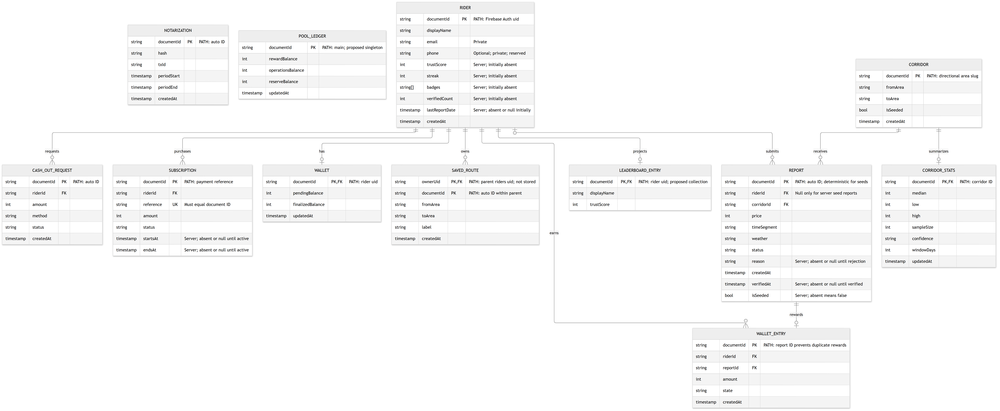

# FairFare ERD and Firestore model

B1 database design. The diagram shows document fields and relationships; the table below maps each entity to its Firestore path and access permissions.

```mermaid
erDiagram
    direction TB

    RIDER ||--o{ SAVED_ROUTE : owns
    RIDER o|--o{ REPORT : submits
    CORRIDOR ||--o{ REPORT : receives
    CORRIDOR ||--o| CORRIDOR_STATS : summarizes
    RIDER ||--o| WALLET : has
    RIDER ||--o{ WALLET_ENTRY : earns
    REPORT ||--o| WALLET_ENTRY : rewards
    RIDER ||--o{ CASH_OUT_REQUEST : requests
    RIDER ||--o{ SUBSCRIPTION : purchases
    RIDER ||--o| LEADERBOARD_ENTRY : projects

    RIDER {
        string documentId PK "PATH: Firebase Auth uid"
        string displayName
        string email "Private"
        string phone "Optional; private; reserved"
        int trustScore "Server; initially absent"
        int streak "Server; initially absent"
        string[] badges "Server; initially absent"
        int verifiedCount "Server; initially absent"
        timestamp lastReportDate "Server; absent or null initially"
        timestamp createdAt
    }
    SAVED_ROUTE {
        string ownerUid PK,FK "PATH: parent riders uid; not stored"
        string documentId PK "PATH: auto ID within parent"
        string fromArea
        string toArea
        string label
        timestamp createdAt
    }
    CORRIDOR {
        string documentId PK "PATH: directional area slug"
        string fromArea
        string toArea
        bool isSeeded
        timestamp createdAt
    }
    CORRIDOR_STATS {
        string documentId PK,FK "PATH: corridor ID"
        int median
        int low
        int high
        int sampleSize
        string confidence
        int windowDays
        timestamp updatedAt
    }
    REPORT {
        string documentId PK "PATH: auto ID; deterministic for seeds"
        string riderId FK "Null only for server seed reports"
        string corridorId FK
        int price
        string timeSegment
        string weather
        string status
        string reason "Server; absent or null until rejection"
        timestamp createdAt
        timestamp verifiedAt "Server; absent or null until verified"
        bool isSeeded "Server; absent means false"
    }
    WALLET {
        string documentId PK,FK "PATH: rider uid"
        int pendingBalance
        int finalizedBalance
        timestamp updatedAt
    }
    WALLET_ENTRY {
        string documentId PK "PATH: report ID prevents duplicate rewards"
        string riderId FK
        string reportId FK
        int amount
        string state
        timestamp createdAt
    }
    CASH_OUT_REQUEST {
        string documentId PK "PATH: auto ID"
        string riderId FK
        int amount
        string method
        string status
        timestamp createdAt
    }
    SUBSCRIPTION {
        string documentId PK "PATH: payment reference"
        string riderId FK
        string reference UK "Must equal document ID"
        int amount
        string status
        timestamp startsAt "Server; absent or null until active"
        timestamp endsAt "Server; absent or null until active"
    }
    LEADERBOARD_ENTRY {
        string documentId PK,FK "PATH: rider uid; proposed collection"
        string displayName
        int trustScore
    }
    POOL_LEDGER {
        string documentId PK "PATH: main; proposed singleton"
        int rewardBalance
        int operationsBalance
        int reserveBalance
        timestamp updatedAt
    }
    NOTARIZATION {
        string documentId PK "PATH: auto ID"
        string hash
        string txId
        timestamp periodStart
        timestamp periodEnd
        timestamp createdAt
    }
```

## Firestore mapping

| Entity | Document path / ID | App access | Server writes |
|---|---|---|---|
| Rider | `riders/{uid}`; Firebase Auth UID | Owner reads; creates `displayName`, `email`, `createdAt`; edits display name | `trustScore`, `streak`, `badges`, `verifiedCount`, `lastReportDate`; reserved optional phone |
| Saved route | `riders/{uid}/savedRoutes/{routeId}`; auto ID | Owner creates, reads, edits, deletes | None required |
| Corridor | `corridors/{corridorId}`; directional area slug | Public read | All fields |
| Corridor statistics | `corridorStats/{corridorId}`; same ID as corridor | Public read | All fields |
| Report | `reports/{reportId}`; auto ID, fixed for seeds | Owner reads; creates pending; edits price or deletes while pending | Status changes, `reason`, `verifiedAt`, seed records |
| Wallet | `wallets/{uid}`; rider UID | Owner read | All fields |
| Wallet entry | `walletEntries/{reportId}`; rewarded report ID (proposed) | Owner read | All fields |
| Cash-out request | `cashOutRequests/{requestId}`; auto ID | Owner reads and creates pending requests | Status changes |
| Subscription | `subscriptions/{reference}`; payment reference | Owner reads and creates pending requests | Status, `startsAt`, `endsAt` |
| Leaderboard entry | `leaderboard/{uid}`; rider UID (proposed) | Public read | Name and score projection |
| Pool ledger | `poolLedger/main` (proposed) | No client access | All fields |
| Notarization | `notarizations/{notarizationId}`; auto ID | Public read | All fields |

## Field conventions

- `PK` identifies a document; `FK` identifies a related document. `documentId` and the saved-route `ownerUid` describe path metadata and are not stored fields. Firestore relationships are enforced by rules/server logic, not SQL foreign keys.
- Dates use Firestore Timestamps. Prices and subscription amounts are whole RWF; wallet values are whole demo points. Passwords and email verification state stay in Firebase Auth.
- Server profile defaults are score/streak/count `0`, badges `[]`, and `lastReportDate` null; they may be absent just after signup. `phone` is optional. `reason`, `verifiedAt`, `startsAt`, and `endsAt` may be absent or null until set by the server. An absent report `isSeeded` means false.
- Time segments: `morning`, `midday`, `evening`, `lateNight`. Weather: `clear`, `heavyRain`. Report status: `pending`, `verified`, `rejected`, `expired`. Subscription status: `pending`, `active`, `rejected`. Cash-out status: `pending`, `paid`, `rejected`. Proposed wallet states: `pending`, `finalized`, `reversed`.
- Proposed confidence labels: `new`, `limited`, `wellCovered`. Proposed cash-out methods: `momo`, `airtel`. Proposed badge IDs: `corridorPioneer`, `weekStreak`, `tenVerified`.
- Proposed seed reports have `isSeeded: true` and no rider. They contribute prices to statistics, but do not corroborate reports or earn rewards/trust. Public leaderboard documents contain only names and scores; private emails stay in rider documents. Corridor statistics are a derived summary of report prices.

Composite query indexes are defined in [firestore.indexes.json](../firestore.indexes.json). Schema proposals remain subject to team review; security rules and emulator tests are B2.
